<!-- 注意: div 内的裸  是行内元素, 会被挤到同一行;
     必须每张图单独用 
 包裹才会上下排列。 -->

<!-- 头像 -->

<!-- 动态打字效果 (自托管) -->

<!-- 仓库 -->

## [个人博客](https://km.woa.qzz.io/)
### Blog
- [自用AI代码质量规范](https://km.woa.qzz.io/blog/2026/10/07/01-AI代码质量) <i>2026-10-07</i>
- [接受审判: I](https://km.woa.qzz.io/blog/2026/09/06/01_部门答辩) <i>2026-09-06</i>
- [Codex Free 号池搭建](https://km.woa.qzz.io/blog/2026/05/17/01_codexFreePool) <i>2026-05-17</i>
- [最近的项目](https://km.woa.qzz.io/blog/2026/05/07/01_最近的项目) <i>2026-05-07</i>
- [博客更新日志 (III)](https://km.woa.qzz.io/blog/2026/04/14/01_博客更新日志) <i>2026-04-14</i>

### Docs
- [简单工厂模式](https://km.woa.qzz.io/docs/%E8%AE%A1%E4%BD%AC%E5%B8%B8%E8%AD%98/%E8%AE%BE%E8%AE%A1%E6%A8%A1%E5%BC%8F/%E5%88%9B%E5%BB%BA%E5%9E%8B%E6%A8%A1%E5%BC%8F/%E7%AE%80%E5%8D%95%E5%B7%A5%E5%8E%82%E6%A8%A1%E5%BC%8F) <i>2026-10-08</i>
- [原型模式](https://km.woa.qzz.io/docs/%E8%AE%A1%E4%BD%AC%E5%B8%B8%E8%AD%98/%E8%AE%BE%E8%AE%A1%E6%A8%A1%E5%BC%8F/%E5%88%9B%E5%BB%BA%E5%9E%8B%E6%A8%A1%E5%BC%8F/%E5%8E%9F%E5%9E%8B%E6%A8%A1%E5%BC%8F) <i>2026-10-08</i>
- [软件视角和系统调用](https://km.woa.qzz.io/docs/%E8%AE%A1%E4%BD%AC%E5%B8%B8%E8%AD%98/%E6%93%8D%E4%BD%9C%E7%B3%BB%E7%BB%9F/%E6%93%8D%E4%BD%9C%E7%B3%BB%E7%BB%9F%E6%80%BB%E8%A7%88/%E8%BD%AF%E4%BB%B6%E8%A7%86%E8%A7%92%E5%92%8C%E7%B3%BB%E7%BB%9F%E8%B0%83%E7%94%A8) <i>2026-10-08</i>
- [操作系统发展史](https://km.woa.qzz.io/docs/%E8%AE%A1%E4%BD%AC%E5%B8%B8%E8%AD%98/%E6%93%8D%E4%BD%9C%E7%B3%BB%E7%BB%9F/%E6%93%8D%E4%BD%9C%E7%B3%BB%E7%BB%9F%E6%80%BB%E8%A7%88/%E6%93%8D%E4%BD%9C%E7%B3%BB%E7%BB%9F%E5%8F%91%E5%B1%95%E5%8F%B2) <i>2026-10-08</i>
- [进程简介及进程编程模型](https://km.woa.qzz.io/docs/%E8%AE%A1%E4%BD%AC%E5%B8%B8%E8%AD%98/%E6%93%8D%E4%BD%9C%E7%B3%BB%E7%BB%9F/%E8%BF%9B%E7%A8%8B%E4%B8%8E%E7%BA%BF%E7%A8%8B/%E8%BF%9B%E7%A8%8B%E7%AE%80%E4%BB%8B%E5%8F%8A%E8%BF%9B%E7%A8%8B%E7%BC%96%E7%A8%8B%E6%A8%A1%E5%9E%8B) <i>2026-10-08</i>

> 更新时间: 2026/10/24 12:59:38 (北京时间) | From [HXLoLi](https://github.com/HengXin666/HXLoLi) [每日凌晨更新]
