<!-- 由 scripts/updateReadme.ts 生成, 每日凌晨更新; 手改会被覆盖 -->

    

                  

更新于 2026/11/29 01:55 (北京时间) · 数据来自 GitHub, WakaTime, <a href="https://github.com/HengXin666/HXLoLi">HXLoLi</a> · 每日凌晨更新&nbsp;&nbsp;

